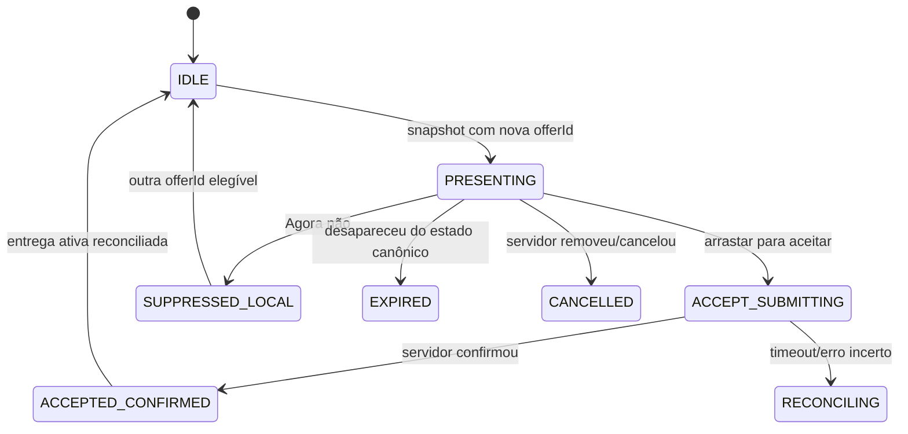

# Auditoria Android V4 — módulo de recebimento de ofertas

Data: 08/10/2026  
Escopo: desenvolvimento local, sem publicação de APK, sem migração e sem alteração de produção.

## Diagnóstico executivo

O aplicativo em operação é Android nativo em Java com Views criadas programaticamente. Não é PWA, WebView, Capacitor, Flutter ou React Native. O mapa é Google Maps nativo. A sessão é guardada com Android Keystore. Localização, consulta de ofertas, áudio, notificação e overlay estão concentrados em `CourierService`.

O defeito central do fluxo de ofertas é estrutural: `CourierService.tick()` aciona notificação, áudio e overlay para o mesmo item sem conhecer se `MainActivity` está em primeiro plano. Ao mesmo tempo, `MainActivity.applyState()` abre outro diálogo com a oferta. O botão “Agora não” apenas fecha a interface local e a mesma entrega volta no polling seguinte. O backend Vuppi possui aceite atômico, mas não possui contrato de recusa de entrega.

## Inventário e matriz de reuso

| Funcionalidade | Evidência | Estado | Fonte/contrato | Risco | Reuso/refactor | Testes |
|---|---|---|---|---|---|---|
| Projeto Android | `mobile/vuppi-entregador-android/app/build.gradle` | EXISTENTE_BOM | `applicationId br.com.vuppidelivery.entregador`, min 24, target 36 | assinatura e atualização | preservar pacote, versão e keystore | build debug/release |
| Sessão persistente | `SessionStore.java` | EXISTENTE_BOM | AES/GCM no Android Keystore | logout/troca de conta | preservar | testes existentes de API; instrumentação pendente |
| Mapa | `MainActivity.java:45` | EXISTENTE_BOM | Google Maps Android SDK | chave/restrições | preservar engine | build + dispositivo pendente |
| Polling de ofertas | `CourierService.java:26-45` | EXISTENTE_INCOMPLETO | `GET /api/delivery/state` a cada 3 s | duplicação, bateria, reconexão | manter fonte e criar coordenador único | unidade e ciclo de vida |
| Oferta em primeiro plano | `MainActivity.java:51-60` | EXISTENTE_INCOMPLETO | `state.offers[0]` | concorre com overlay | reutilizar diálogo como OfferSheet | unidade + UI pendente |
| Overlay de oferta | `CourierService.java:77-81` | EXISTENTE_INCOMPLETO | `SYSTEM_ALERT_WINDOW` | duplicação e janela órfã | manter WindowManager, controlar por contexto | instrumentação pendente |
| Notificação Android | `CourierService.java:46-51` | EXISTENTE_INCOMPLETO | canal `vuppi_offers_v55` | heads-up junto com overlay | emitir somente quando overlay não for o apresentador | unidade + dispositivo |
| Áudio de oferta | `CourierService.java:52-65` | EXISTENTE_INCOMPLETO | `MediaPlayer` + `vuppi_delivery.mp3` | triplo alerta, uso ALARM | controlador exclusivo e cleanup | unidade + dispositivo |
| Aceite | `server/delivery.mjs:34,83` e migração `202610040006_delivery_idempotency_and_courier.sql` | EXISTENTE_BOM | ação `accept`, validação transacional | conflito entre entregadores | preservar; parar alerta antes do POST | integração já existente; conflito real pendente |
| Recusa | ausência em `server/delivery.mjs:34` e RPC Vuppi Delivery | AUSENTE | nenhum endpoint/evento real | mesma OS reaparece | tombstone local provisório; contrato servidor exige aprovação | unidade local; integração futura |
| Pendências | `state.offers` é lista de ofertas gerais | INDETERMINADO | não existe evento/endpoint separado | não é possível diferenciar som/regra | aguardar contrato real; não fabricar | pendente |
| Bolha flutuante | `CourierService.java:66-75` | EXISTENTE_INCOMPLETO | WindowManager | sem descarte/snap/persistência | evolução após estabilizar ofertas | instrumentação futura |
| Banner 640×275 | nenhum módulo Android/backend localizado | AUSENTE | contrato conceitual somente | hardcode sem gestão | propor após oferta confiável | pendente de aprovação backend |

## Máquina de estados aplicada no cliente

`SUPPRESSED_LOCAL` não equivale a recusa definitiva. Ele impede repetição visual/sonora no mesmo aparelho por tempo limitado, enquanto o servidor ainda não oferece `offer.reject`.

## Matriz de apresentação

| Contexto | Apresentador único |
|---|---|
| Activity em primeiro plano | OfferSheet interna; sem overlay e sem heads-up |
| Background com overlay autorizado | overlay; notificação cancelada |
| Background sem overlay | notificação Android com deep link |
| Oferta removida, logout ou serviço encerrado | áudio, vibração, overlay e notificação limpos |

## Plano incremental

1. **PR 1 — coordenador e deduplicação:** estado puro testável, tombstone local, visibilidade da Activity, apresentador único, parada imediata do áudio e privacidade da notificação.
2. **PR 2 — recusa real:** contrato aditivo `offer.reject`, auditoria e exclusão por `courier + delivery`; exige autorização antes de modificar backend/migração.
3. **PR 3 — pendências:** somente após localizar/definir elegibilidade e evento distinto de oferta.
4. **PR 4 — bolha v2:** círculo 48dp, snap, alvo ocultar e preferência por usuário.
5. **PR 5 — OfferSheet e Home premium:** tokens, hierarquia, acessibilidade e screenshots instrumentados.
6. **PR 6 — atividades/banner:** reutilizar gestão se criada; qualquer backend novo passa por gate.

## Riscos e rollback

- O polling de 3 segundos permanece por compatibilidade; push não será introduzido em paralelo.
- Android pode limitar serviço/overlay conforme versão e fabricante; o fallback é notificação.
- Rollback do PR 1 consiste em restaurar `CourierService`/`MainActivity` e remover as classes de coordenação; não há alteração de banco.
- Nenhum artefato desta fase será copiado para `dist/downloads`, para o site ou para a Play Store.

## Gate necessário para recusa real

Para concluir “Recusar” de ponta a ponta é necessário autorizar uma mudança aditiva no backend e banco: ação autenticada e idempotente, registro por entregador/entrega, filtro na consulta de ofertas, auditoria, expiração/rollback e testes de concorrência. Até esse gate, o aplicativo deve chamar a ação de **Agora não** e declarar a supressão como local.

## Incremento local concluído — coordenador de ofertas

Arquivos modificados/criados:

- `CourierService.java`: um apresentador por contexto, áudio exclusivo, limpeza de overlay/notificação, aceite single-flight, notificação privada e supressão local.
- `MainActivity.java`: OfferSheet em primeiro plano, parada imediata do alerta ao aceitar, “Agora não” persistente no aparelho e seleção da primeira oferta elegível.
- `OfferStateMachine.java`: máquina de estados pura para deduplicação, aceite, reconciliação e expiração.
- `OfferDecisionStore.java`: tombstone local de 24 horas por `deliveryId`, limpo no logout.
- `SlideActionView.java`: confirmação deliberada por arraste com feedback háptico.
- `OfferStateMachineTest.java`: seis cenários unitários de repetição, supressão, concorrência local, reconciliação, aceite confirmado e expiração.
- `app/build.gradle`: JUnit 4 para testes locais.

Comparativo comportamental desta etapa:

| Antes | Depois no build de desenvolvimento |
|---|---|
| Sheet + overlay + heads-up podiam concorrer pela mesma oferta | foreground usa sheet; background usa overlay autorizado ou notificação |
| O som podia ser iniciado por snapshots repetidos | somente a transição `NEW` inicia o áudio |
| “Agora não” apenas fechava a janela | fecha, interrompe áudio/vibração e impede reapresentação local da mesma entrega |
| Snapshot antigo após aceite/timeout podia reconstruir UI | estados `ACCEPTED_CONFIRMED` e `RECONCILING` não são apresentáveis |
| Notificação expunha dados operacionais | lockscreen recebe texto genérico com `VISIBILITY_PRIVATE` |
| Player podia permanecer ativo | aceite, supressão, expiração, logout e destruição liberam player, foco de áudio e vibração |
| Oferta tinha hierarquia visual rasa | valor em 30sp, identidade da loja, rota numerada, orientação de aceite e CTA por arraste |

## Validação executada em 08/10/2026

- `gradlew testDebugUnitTest`: **6 testes, 0 falhas, 0 erros**.
- `gradlew assembleDebug`: **BUILD SUCCESSFUL**.
- `npm.cmd test`: suíte existente aprovada, inclusive oferta única, aceite idempotente, autenticação, delivery e financeiro.
- APK local: `mobile/vuppi-entregador-android/app/build/outputs/apk/debug/app-debug.apk`.
- Nenhum APK foi copiado para o site, publicado ou instalado em dispositivo.

Teste instrumentado e screenshots “depois” ainda dependem de um aparelho/emulador acessível pelo ADB. O ambiente atual bloqueia a pasta global usada pelo ADB; portanto, este relatório não afirma validação visual ou de fabricante que não ocorreu. Os vídeos de baseline foram localizados, mas não foram usados para inferir contratos backend.
